# AGENTS.md — Research Repo

Canonical instructions for AI agents working in this repository (Cursor, Claude Code, Gemini CLI, and external A2A agents).

## Purpose

This repo runs **AI-assisted research** on topics its human owner curates. Findings are a **source-of-truth OKF document bundle**: Markdown conforming to **OKF v0.1** under [`research/`](research/). Topics, tasks, budget, and approvals make the research autonomous but human-steered — the owner tailors topics to avoid other people's filters and bias, and stays in the loop on approvals.

## Non-negotiables

1. **Document packages only** for research output in `research/` and `templates/`: each concept is a directory with `document.md` + `convert.yaml`.
2. **OKF frontmatter required** on every `document.md` (`type` is mandatory). Reserved files `index.md` and `log.md` do not use concept frontmatter (root `index.md` may declare `okf_version`).
3. **Docs stay true.** If a new finding conflicts with an existing concept, **surface the conflict** — do not silently invent a merge. When researchers disagree, preserve the disagreement.
4. **Cite everything.** Findings without citations do not get committed.
5. **Respect topic filters.** Every topic's "Interested in" / "Not interested in" sections are binding scope for researchers.
6. **Humans approve**: new topics, new experiments (`start-experiment`), anything shared outside this environment (`share-results`), and any task estimated above the auto-approve cap in [`budget.yaml`](budget.yaml).
7. **Prefer bundle-relative absolute links** from the research root: `[Finding](/findings/slug/document.md)`; topics as `[Topic](/../topics/slug/topic.md)`.
8. **Edit harness sources once:** `AGENTS.md`, `.agents/skills/`, `.agents/agents/`. Do not duplicate instructions into tool-specific wrappers except for tool-only notes.

## Repo map

| Path | Purpose |
|------|---------|
| `research/` | OKF bundle: `findings/`, `experiments/`, `digests/` |
| `topics/` | Human-curated research topics with interest filters and seed references |
| `tasks/` | Task queue (`queue/`), type definitions (`task-types.yaml`), effort ledger (`ledger.md`) |
| `approvals/` | Human-in-the-loop inbox (`pending/`) and archive (`resolved/`) |
| `budget.yaml` | Effort budget, auto-approve rules, estimation config |
| `templates/` | OKF starter packages: `topic`, `finding`, `experiment`, `source-review`, `digest`, `reference` |

## Research lifecycle

```mermaid
flowchart LR
    topic[Topic proposed] -->|human approves| tasksNode[Manager creates tasks]
    tasksNode --> poker[Planning poker estimates]
    poker -->|within budget| auto[Auto-approved]
    poker -->|over cap or gated type| humanNode[Human approval]
    humanNode -->|approve or adjust| auto
    auto --> researchNode[Researcher executes]
    researchNode --> commit[Finding committed to research/]
    commit --> digest[Publicist digest]
    digest -->|human approves share-results| publish[Wiki / blog / notifications]
```



## Effort estimation (planning poker)

- Scale: Fibonacci points `1, 2, 3, 5, 8, 13, 21, 34, 55`. **Anchor: 13** = a typical single-source research pass. Adjust up/down in Fibonacci increments; unknown unknowns push estimates up.
- Researchers estimate independently; the manager records consensus as the task `size` and re-polls on wide spread.
- On completion each agent reports **actual** effort on the same scale; the manager reconciles in `tasks/ledger.md`.
- Budget and auto-approve thresholds: [`budget.yaml`](budget.yaml). Task types and calibration anchors: [`tasks/task-types.yaml`](tasks/task-types.yaml).

## Shared subagents

Personas in [`.agents/agents/`](.agents/agents/):

| Agent | Role |
|-------|------|
| `research-manager` | Budget, planning poker, prioritization, approvals routing. Never researches. |
| `researcher` | Base persona: execute tasks, commit findings, report effort |
| `researcher-alpha` | Variant on Claude Opus — deep synthesis stance |
| `researcher-bravo` | Variant on Claude Fable — breadth-first stance |
| `researcher-charlie` | Variant on Grok — contrarian stance |
| `researcher-delta` | External variant (local Qwen / Kimi K3) over A2A — independent verification stance |
| `publicist` | Digests completed research; drives human-gated publishing |
| `research-librarian` | Bundle and index maintenance |

Researchers can run as **subagents** (Claude Code / Cursor / Gemini pick up the persona files) or as **external agents over A2A** via the `research-apps` gateway — `researcher-delta` documents that mode. Multiple models with declared stances are deliberate bias-balancing: assign the same source to two variants when a topic is contested.

## Project skills

Shared skills live in [`.agents/skills/`](.agents/skills/) (bridged for Claude via `pnpm link-harness`).

| Skill | Use when |
|-------|----------|
| `okf-author` | Creating or updating OKF concepts, indexes, links |
| `research-task` | Estimating, executing, and closing tasks (per-type playbooks) |
| `topic-intake` | Proposing/validating topics and routing approval |
| `publish-digest` | Building digests and human-gated sharing |
| `deconstruct-document` | Importing papers/reports into OKF packages |
| `convert-document` | Exporting Markdown to PDF/DOCX/HTML/PPTX |
| `research-audit` | Checking OKF, topic, and task conformance |

## Scheduling autonomous runs

Agents are designed to be invoked headlessly on a schedule (cron, Task Scheduler, CI):

```bash
# Manager pass: estimates, approvals routing, assignment, ledger reconciliation
claude -p "Act as the research-manager agent. Process tasks/, budget.yaml, and approvals/. Commit your changes."

# Researcher pass
claude -p "Act as researcher-alpha. Execute your assigned approved tasks from tasks/queue/. Commit findings."

# Publicist pass (e.g. weekly)
claude -p "Act as the publicist agent. Build this period's digest and raise share-results tasks."
```

External researchers (local models) poll the `research-apps` A2A gateway instead. Notifications (pending approvals, new digests) go through `research-notify` from `research-apps`.

## Repo init

After clone (or when resetting navigation metadata): `pnpm init-repo` installs deps (from GitHub Packages), links the AI harness, rebuilds `research/log.md`, `index.md` files, and `topics/index.md` from existing packages, then runs `okf:check`. It never deletes concept or topic packages. Set `NODE_AUTH_TOKEN` for GitHub Packages (see root README).

## Convert / deconstruct

Pandoc must be installed; Mermaid CLI (`mmdc`) when a package enables it. CLIs ship from [doc-repo-tools](https://github.com/dukk/doc-repo-tools):

```bash
pnpm convert research/digests/2026-w29
pnpm deconstruct imports/paper.pdf --out research/findings/paper-review
```

## Harness bridges

| Tool | Entry | Skills / agents |
|------|-------|-----------------|
| Cursor | `AGENTS.md` + `.cursor/rules/` | Reads `.agents/skills/` natively |
| Claude Code | `CLAUDE.md` → this file | `.claude/skills`, `.claude/agents` (linked) |
| Gemini CLI | `GEMINI.md` → this file | `.agents/skills/` native; `.gemini/agents` linked |
| External (A2A) | `research-apps` gateway | Task pull / result submission over A2A |

After clone: `pnpm install` (runs `link-harness`) or `pnpm link-harness`.
